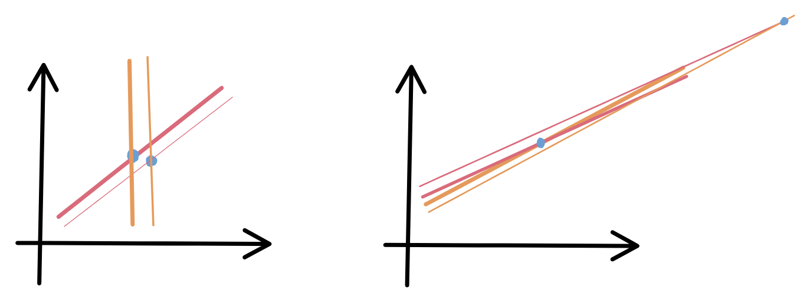

## The setting

Say we want to solve a linear system $A\bar{x}=\bar{b}$. We are interested in seeing how a small error in $\bar{b}$ influences the solution $\bar{x}$.

To start simple, consider a 2D problem. We want solution to two line intersection. We find the intersection point. What we now want to see is if I perturb the lines slightly, how much does the intersection point change. We can imagine that if the lines have a healthy angle between them, the intersection doesn't change much. But if they are nearly parallel, small perturbation changes the intersection point significantly. See the diagram below:

Assuming $A$ is invertible, we have

$$
\begin{aligned}
A(\bar{x}+\delta\bar{x}) &= \bar{b}+\delta\bar{b} \\
A\bar{x} + A\delta\bar{x} &= \bar{b} + \delta\bar{b} \\
\delta\bar{x} &= A^{-1}\delta\bar{b}
\end{aligned}
$$

Multiplying by a matrix stretches and rotates the vector. $\|M\|$ be the maximum stretch $M$ can induce on a vector. Then

$$\|\delta\bar{x}\| \le \|A^{-1}\| \|\delta\bar{b}\|$$

Similarly, since $A\bar{x}=\bar{b}$, $\|\bar{b}\| \le \|A\| \|\bar{x}\|$ or

$$\frac{1}{\|\bar{x}\|} \le \frac{\|A\|}{\|\bar{b}\|}$$

Multiplying both:

$$\begin{equation}
\frac{\|\delta\bar{x}\|}{\|\bar{x}\|} \le \underbrace{\|A\| \|A^{-1}\|}_{\kappa(A)} \frac{\|\delta\bar{b}\|}{\|\bar{b}\|}
\end{equation}$$

## How much can $A$ stretch?

Let $A \in \mathbb{R}^{m \times n}$. Let's define $A^T A = M \in \mathbb{R}^{n \times n}$. $M$ is a real symmetric matrix. We will spend some time analysing the properties of $M$.

- $\bar{x}^T M \bar{x} = \bar{x}^T A^T A \bar{x} = \|A\bar{x}\|_2^2 \ge 0$
  $\therefore M$ is positive semidefinite
- Let $\bar{v}$ be a complex vector. Define $c = \bar{v}^* M \bar{v}$.
  The (complex conjugate of $c$) = $c^* = (\bar{v}^* M \bar{v})^* = \bar{v}^* M^* \bar{v}$
  Since $M$ is real and symmetric, $M^* = M \implies c = c^*$
  i.e. $c$ is a real number
- If $\bar{v}$ is an eigenvector, $c = \bar{v}^* M \bar{v} = \lambda \bar{v}^* \bar{v} = \lambda \|\bar{v}\|_2^2$
  $c$ is real, $\|\bar{v}\|_2^2$ is real, so $\lambda$ is real
- Let $\bar{v}_i$ be eigenvector of $M$ with corresponding eigen value $\lambda_i$
  $\bar{v}_i^T M \bar{v}_i = \bar{v}_i^T A^T A \bar{v}_i = \|A\bar{v}_i\|_2^2$
  $\bar{v}_i^T M \bar{v}_i = \bar{v}_i^T \lambda_i \bar{v}_i = \lambda_i \|\bar{v}_i\|_2^2$
  $\|A\bar{v}_i\|_2^2 = \lambda_i \|\bar{v}_i\|_2^2 \implies \lambda_i \ge 0$

- Given $\bar{v}$, eigenvector of $M$, $\bar{v} \in \mathbb{R}^n$. Consider perpendicular space $W$. Lets see what the component of $M\bar{w}$ is along $\bar{v}$. $\bar{v}^T M \bar{w} = (M^T \bar{v})^T \bar{w} = (M \bar{v})^T \bar{w} = \lambda \bar{v}^T \bar{w} = 0$
  So $M$ maps $W$ back onto itself. Consider the matrix $M' = (M - \lambda \bar{v} \bar{v}^T)$. $(M')^T = M^T - \lambda \bar{v} \bar{v}^T = M'$.
  $M' \in \mathbb{R}^{n \times n}$ is also a symmetric matrix which maps $\bar{w} \in W$ to $W$. If we find one eigenvector of $M'$ such that $M' \bar{w} = \mu \bar{w}$, we have
  $M' \bar{w} = M \bar{w} - \lambda \bar{v} \bar{v}^T \bar{w} = M \bar{w} = \mu \bar{w}$, we basically found another eigenvector of $M$ perpendicular to $\bar{v}$. We can repeat this and we will end up with $n$ mutually orthogonal eigenvectors of $M$ which form basis of $\mathbb{R}^n$.

$$
\begin{aligned}
M \bar{v}_i &= \lambda_i \bar{v}_i \\
\Rightarrow M \underbrace{\begin{bmatrix} \bar{v}_1 & \bar{v}_2 & \cdots & \bar{v}_n \end{bmatrix}}_{V} &= \underbrace{\begin{bmatrix} \bar{v}_1 & \bar{v}_2 & \cdots & \bar{v}_n \end{bmatrix}}_{V} \underbrace{\begin{bmatrix} \lambda_1 & & & \\ & \lambda_2 & & \\ & & \ddots & \\ & & & \lambda_n \end{bmatrix}}_{\Lambda}
\end{aligned}
$$

$V$ is orthonormal $\Rightarrow V^T V = I \Rightarrow V^{-1} = V^T$

$$\begin{equation}
\begin{aligned}
M V &= V \Lambda \\
\Rightarrow M &= V \Lambda V^T
\end{aligned}
\end{equation}$$

Spectral theorem

* Algebraic Multiplicity = Geometric Multiplicity.

$$
\begin{aligned}
M = V \Lambda V^T &\Rightarrow \det(V \Lambda V^T - x I) = 0 \\
&\phantom{\Rightarrow} \det(V \Lambda V^T - V x I V^T) = 0 \\
&\phantom{\Rightarrow} \det(V (\Lambda - x I) V^T) = 0
\end{aligned}
$$

Using $\det(AB) = \det(A)\det(B)$ when $A$ and $B$ are square:

$$
\begin{aligned}
\det(V^T V) = \det(V V^T) = \det(I) &= 1 \\
\det(V^T)\det(V) = \det(V)\det(V^T) &= 1 \\
\det(V) = \det(V^T) &\Rightarrow \det(V) = \pm 1 \\
\therefore \det\big(V (\Lambda - x I) V^T\big) &= \det(\Lambda - x I) = 0
\end{aligned}
$$

$$
\Rightarrow \prod(\lambda_i - x) = 0
$$

Algebraic multiplicity is the number of times $\lambda_i$ repeats $\ge 1$

Geometric Multiplicity : dimension of nullspace of $M - \lambda_i I$.

$$
\begin{aligned}
\dim(\text{null}(M - \lambda_i I)) &= \dim(\text{null}(V (\Lambda - \lambda_i I) V^T))
\end{aligned}
$$

Since $V$ is full rank,

$$
\begin{aligned}
\text{null}(V (\Lambda - \lambda_i I) V^T) &= \text{null}(V (\Lambda - \lambda_i I)) \\
&= \text{null}(\Lambda - \lambda_i I)
\end{aligned}
$$

$$
(\Lambda - \lambda_i I) \bar{x} = 0 \Rightarrow (\lambda_j - \lambda_i) x_j = 0
$$

Non zero $x_j$ found when $\lambda_j = \lambda_i \Rightarrow$ Symmetric matrix has algebraic multiplicity = geometric multiplicity

### Singular Value Decomposition

Using the spectral theorem:

$$
A^T A = M = V \Lambda V^T
$$

$\text{rank}(M) \leqslant \min(\text{rank}(A^T), \text{rank}(A))$. $A \in \mathbb{R}^{m \times n}$
$\text{rank}(A) \leqslant \min(m, n)$. So $\text{rank}(M) \leqslant \min(m, n)$.

If $n > m$, $\text{rank}(M) \leqslant m$

If $n < m$, $\text{rank}(M) \leqslant n$

$M \in \mathbb{R}^{n \times n}$. From rank nullity theorem:

$$
n = \text{rank}(M) + \text{nullity}(M)
$$

If $M$ has zero eigenvalue with algebraic and geometric multiplicity $K$, every vector in the subspace spanned by corresponding eigenvectors belongs to the null space of $M$.
$\bar{x} = \sum_{i=1}^{K} \alpha_i \bar{v}_i \Rightarrow M\bar{x} = \sum_{i=1}^{K} \alpha_i \underset{0}{M\bar{v}_i} = 0$

$\therefore \text{nullity}(M) = K$

Consider $\|A \bar{v}_i\|_2^2$ where $\bar{v}_i$ is eigenvector of $M$.

$$
\|A \bar{v}_i\|_2^2 = \bar{v}_i^T A^T A \bar{v}_i = \bar{v}_i^T \lambda_i \bar{v}_i = \lambda_i
$$

Lets define $\|A \bar{v}_i\| = \sigma_i = \sqrt{\lambda_i} \quad (\lambda_i \geqslant 0)$
and the unit vector $\frac{A\bar{v}_i}{\|A\bar{v}_i\|} = \frac{A\bar{v}_i}{\sigma_i} = \bar{u}_i$

for every eigenvector $\bar{v}_i$ whose corresponding eigen value is non-zero. We notice that $\bar{u}_i$ are mutually orthogonal.

$$
\bar{u}_i^T \bar{u}_j = \frac{\bar{v}_i^T A^T A \bar{v}_j}{\sigma_i \sigma_j} = \frac{\sigma_j}{\sigma_i} \bar{v}_i^T \bar{v}_j = 0
$$

We can use $\bar{u}_i$ as basis of $\mathbb{R}^m$ and complete the basis by identifying $m - (n-k)$ or $m - r$ more vectors which are mutually orthogonal ($r$ is $\text{rank}(M)$, $K$ is nullity of $M$).

$$
A\bar{v}_i = \sigma_i \bar{u}_i \quad, i = 1, 2, 3 \cdots n
$$

For $i \leqslant r, \sigma_i \neq 0$. For $r < i \leqslant n, \sigma_i = 0$

$$
A[\bar{v}_1, \bar{v}_2 \dots \bar{v}_n] = [\bar{u}_1, \bar{u}_2 \dots \bar{u}_m] \begin{bmatrix} \sigma_1 & & & \\ & \sigma_2 & & \\ & & \ddots & \\ & & & \sigma_r & \\ & & & & 0 & \\ & & & & & \ddots & 0 \end{bmatrix}
$$

$$\begin{equation}
AV = U \Sigma \Rightarrow A = U \Sigma V^T
\end{equation}$$

## What multiplying with $A$ does?

$$
A\bar{x} = U \Sigma V^T \bar{x}
$$

* $V^T \bar{x}$ rotates $\bar{x}$ as $V$ is orthonormal
* $\Sigma$ scales each component of a vector
* $U$ again rotates a vector.

So if $\sigma_1 \geqslant \sigma_2 \geqslant \sigma_3 \dots \sigma_r$,

$$\begin{aligned}
\|A\bar{x}\| &= \sqrt{\sigma_1^2 x_1^2 + \sigma_2^2 x_2^2 + \dots \sigma_r^2 x_r^2 + 0 \dots 0} \\
&= |\sigma_1| \sqrt{x_1^2 + \left(\frac{\sigma_2}{\sigma_1}\right)^2 x_2^2 + \dots \left(\frac{\sigma_r}{\sigma_1}\right)^2 x_r^2 + 0 \dots 0} \\
&\leqslant |\sigma_1| \sqrt{x_1^2 + x_2^2 + \dots x_n^2} \\
&\leqslant |\sigma_1| \|\bar{x}\|
\end{aligned}$$

So the maximum stretch $A$ can do is the magnitude of largest singular value of $A$.

## Condition number

When $A$ is square and invertible,

$$\begin{aligned}
A^{-1} &= (U \Sigma V^T)^{-1} \\
&= (V^T)^{-1} \Sigma^{-1} U^{-1} \\
&= V \underbrace{\Sigma^{-1}}_{\text{SVD with singular values} = 1/\sigma_i} U^T
\end{aligned}$$

$$\|A\| = \sigma_{\max}$$

$$\|A^{-1}\| = \frac{1}{\sigma_{\min}}$$

$$\therefore \kappa(A) = \frac{\sigma_{\max}}{\sigma_{\min}}$$
